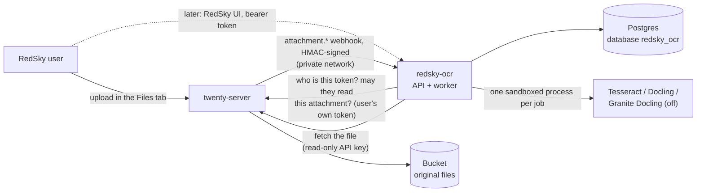

# redsky-ocr

RedSky's document extraction service. It turns files attached to RedSky records (PDFs, scans, photos, Word, PowerPoint and Excel files) into page-referenced text, Markdown, tables and retrieval chunks. Everything runs on CPU inside the service: no document content goes to an outside OCR or AI service, and there are no per-page fees.

It is a side service in the sense of [`RSM_ARCHITECTURE.md`](../../../RSM_ARCHITECTURE.md) §3.5 and §8.1: Python, outside Twenty, talking to Twenty only through its public APIs. No Twenty code was changed for it.

## How it fits



- **Originals stay in Twenty.** A document here is always a Twenty attachment, stored in the existing Bucket. This service keeps only what it derives: text, Markdown, tables, chunks, Docling's document model and processing state.
- **Twenty decides who sees what.** Every read re-checks, with the caller's own token, that Twenty still lets them read the source attachment. Twenty in turn hides an attachment whose parent record the caller cannot read. Extracted text therefore follows the file's permissions, including RSM access control (deal walls) when it lands in Twenty's query path. Anything the caller cannot see is reported as not found.
- **Ingestion is automatic.** Twenty sends `attachment.created` to the service, which queues the file. `attachment.deleted` and `attachment.destroyed` purge everything derived from it. Twenty does not retry webhooks and rate-limits them, so a sweep every `REDSKY_OCR_RECONCILE_INTERVAL_SECONDS` (600) lists recent attachments with the service's API key and queues any that were missed. Files from before deployment are a deliberate choice: `redsky-ocr backfill --since 2026-01-01`.
- **Reused infrastructure:** Twenty (identity, permissions, file storage, upload UI), the existing Postgres server (a separate database), Railway. **New:** one Railway service. No Redis, no second bucket, no queue product: the queue is a Postgres table.

## Extraction

One engine runs per document, chosen by `auto` routing or named by the caller:

| Input | `auto` uses | What happens |
|---|---|---|
| DOCX, PPTX, XLSX | `docling` | Parsed natively (python-docx, python-pptx, openpyxl through Docling). Never OCRed. Headings, lists and tables kept; slides and sheets become pages |
| PDF | `docling` when its layout models are present, else `tesseract` | Each page is probed first. Pages with a usable text layer are read directly; only pages without one (or with a broken one, such as `(cid:12)` runs) are OCRed |
| PNG, JPEG, TIFF (multi-page) | `docling` when its layout models are present, else `tesseract` | OCRed |

| Engine | Does | Needs |
|---|---|---|
| `tesseract` | PDF text layer through pypdfium2, Tesseract OCR for the rest. Page text and confidence; **no table structure** | Nothing beyond the image |
| `docling` | Docling's layout model (headings, reading order) and TableFormer (tables), with Tesseract on bitmap regions only | Layout and TableFormer models baked into the image (`WITH_DOCLING_MODELS=true`), torch (CPU) |
| `granite_docling` | IBM's Granite Docling vision-language model, for layouts the others get wrong | **Off by default.** `remote` mode calls an OpenAI-compatible endpoint serving `ibm-granite/granite-docling-258M` on RSM hardware; `local` mode runs it here (slow on CPU) |

After extraction, quality checks flag empty output, mostly blank pages, garbled text and mean OCR confidence below `REDSKY_OCR_OCR_MIN_CONFIDENCE`. Flagged documents end as `needs_review` instead of `completed`.

Files whose name carries the RSM Deal System's `_NOAI` tag are recorded but never extracted, and cannot be reprocessed (§12.7: nobody can waive `_NOAI`).

### Model and dependency provenance

RSM excludes Chinese-developed OCR and foundation models. What runs here:

| Component | Origin | Licence | Notes |
|---|---|---|---|
| Docling (`docling-slim`, `docling-core`, `docling-parse`, `docling-ibm-models`) | IBM Research, now LF AI & Data | MIT | Installed as `docling-slim` with chosen extras. **Not** `docling`: that pulls `docling-slim[standard]`, which installs RapidOCR |
| Layout model `docling-project/docling-layout-heron` | IBM | Permissive per IBM's Docling docs; **confirm on the model card** | RT-DETRv2 architecture. RT-DETR was published by Baidu researchers; the weights here are IBM's, run through Hugging Face `transformers`. **Check the model card for whether IBM initialised training from Baidu's published checkpoints** before production: the build environment for this change could not reach Hugging Face |
| TableFormer `docling-project/docling-models` (`v2.3.0`) | IBM | Permissive per IBM's Docling docs; **confirm on the model card** | |
| Granite Docling 258M (optional) | IBM | Apache-2.0 (IBM's announcement; confirm on the model card) | IDEFICS3 architecture (Hugging Face), SigLIP2 vision encoder (Google), Granite LM (IBM) |
| Tesseract 5.3.4 and `eng` model | HP, then Google; Ubuntu packages | Apache-2.0 | |
| pypdfium2 / PDFium | Google | Apache-2.0 / BSD-3 | |
| torch, torchvision (CPU builds) | Meta / Linux Foundation | BSD-3 | From PyTorch's own index |
| FastAPI, uvicorn, httpx, psycopg | various | MIT, BSD-3, BSD-3, LGPL-3.0 | psycopg is used as an unmodified library |

Guards, not just intentions:
- `policy.py` refuses to start the service if `rapidocr`, `paddleocr`, `paddlepaddle`, `paddlex`, `qwen-vl-utils`, `modelscope`, `mineru`, `magic-pdf`, `deepseek-ocr` or `easyocr` is installed, or if the model folder holds anything not on its allow-list. `tests/test_policy.py` checks the same.
- The OCR engine is always named (`TesseractCliOcrOptions`). Docling's automatic choice would pick RapidOCR or EasyOCR if either were ever present.
- Granite Docling is the only VLM preset the code can select; Docling's Qwen, DeepSeek-OCR, GOT-OCR and MinerU presets are unreachable.
- `scripts/download_models.py` fetches named repositories only. Docling's own downloader is not used: its defaults also fetch RapidOCR weights.
- Docling's `vlm` extra is not installed; it brings `qwen-vl-utils`. Granite Docling needs only `transformers` and `accelerate` (the `granite` extra).

## API

All `/api/v1` endpoints except the webhook need `Authorization: Bearer <RedSky access token>`: the same token the Twenty web app holds. API keys are refused, since access is decided per user. Responses use Twenty's camelCase.

| Method and path | Purpose |
|---|---|
| `POST /api/v1/documents` | JSON `{"attachmentId", "engine"?}` registers an existing attachment. Multipart `file`, `linkedObject` (`company`, `person`, `opportunity`, any object name), `linkedRecordId`, `engine`? stores the file in Twenty as an attachment on that record, with the caller's permissions, then registers it. `202` when queued, `200` when it already existed |
| `GET /api/v1/documents` | List, filtered by `attachmentId`, `linkedObject`, `linkedRecordId`, `status`; `limit` up to 100 |
| `GET /api/v1/documents/{id}` | Metadata, status, latest and current extraction, quality report, errors |
| `GET /api/v1/documents/{id}/content` | `format=json` (default: Markdown, text and pages with methods and confidence), `markdown` or `text`; `download=true` for a file. `409 CONTENT_NOT_READY` until the first extraction finishes |
| `GET /api/v1/documents/{id}/tables` | Tables as cell grids and Markdown, with page numbers |
| `GET /api/v1/documents/{id}/chunks` | Retrieval chunks (about 1,500 characters) with heading path and page range, for later embeddings and cited answers |
| `POST /api/v1/documents/{id}/reprocess` | `{"engine"}`. `409 EXTRACTION_IN_PROGRESS` if another engine is already queued, `422 ENGINE_UNAVAILABLE` if that engine is off. The previous result stays readable until the new one completes |
| `GET /api/v1/search?q=` | Full-text search (Postgres, English) over current extractions, with page numbers and highlighted snippets, filtered to what the caller can see |
| `GET /api/v1/engines` | Which engines and formats are usable in this deployment |
| `POST /api/v1/webhooks/twenty` | Twenty webhook receiver. HMAC-SHA256 over `timestamp:body` (`X-Twenty-Webhook-Signature`, `X-Twenty-Webhook-Timestamp`); requests older than five minutes are refused. 404 when no secret is configured |
| `GET /health`, `GET /ready` | Liveness; readiness (database and Tesseract) |

OpenAPI: `GET /api/v1/openapi.json`. There is no interactive documentation page.

**Statuses:** `uploaded` (recorded, not queued: `_NOAI`, or auto-processing off), `queued`, `processing`, `completed`, `failed`, `needs_review`. A document keeps serving its last good extraction while a reprocess runs or after one fails (`contentAvailable`).

**Errors** carry a stable `code`: `EMPTY_FILE`, `FILE_TOO_LARGE`, `UNSUPPORTED_TYPE`, `MACRO_ENABLED`, `ARCHIVE_BOMB`, `ENCRYPTED_FILE`, `CORRUPT_FILE`, `TOO_MANY_PAGES`, `IMAGE_TOO_LARGE`, `MALWARE_DETECTED`, `MALWARE_SCAN_FAILED`, `ENGINE_UNAVAILABLE`, `ENGINE_FAILED`, `PROCESSING_TIMEOUT`, `WORKER_CRASHED`, `SOURCE_UNAVAILABLE`, `SOURCE_DELETED`, `NO_AI_DOCUMENT`.

## Processing and the queue

- The queue is the `redsky_ocr.extraction` table. Workers claim with `FOR UPDATE SKIP LOCKED`, heartbeat every 15 seconds, and a job whose heartbeat stops for two minutes is handed back. Only the worker holding a job can record its result.
- One queued or running extraction per document: duplicate webhooks and repeated requests collapse onto it.
- Retryable failures (Twenty unreachable, scanner unreachable, a crashed worker) back off 30 s, 60 s, 120 s, up to `REDSKY_OCR_JOB_MAX_ATTEMPTS`. Problems with the file itself fail at once.
- Each job runs in a fresh process in its own session. It is killed with its Tesseract children at `REDSKY_OCR_JOB_TIMEOUT_SECONDS`. The downloaded file and page images live in a per-job directory (mode 700) that is always deleted, also after a kill.
- `redsky-ocr backfill --since <date>` moves the sweep's cursor back, so the next sweep queues every attachment created since then.
- `redsky-ocr serve` runs the API and `REDSKY_OCR_WORKER_CONCURRENCY` worker threads in one process. Threads only orchestrate; the extraction work is in the job processes. `redsky-ocr api` and `redsky-ocr worker` split the roles into separate services when needed, with no code change.

## Data

Database `redsky_ocr` (its own login, on the existing Postgres server), schema `redsky_ocr`:

| Table | Holds |
|---|---|
| `document` | One per attachment: workspace, attachment and file ids, filename, MIME type (sniffed), size, SHA-256, linked record, uploader, `no_ai`, status, current extraction |
| `extraction` | One per processing run, and the job queue: requested and actual engine and version, attempts, routing decisions, quality report, full Markdown and text, errors, timings |
| `page` | Text and Markdown per page, method (`text_layer`, `ocr`, `native`, `layout`, `layout_ocr`, `vlm`), OCR confidence, size, full-text index |
| `extracted_table` | Cells as JSON, Markdown, page, caption |
| `chunk` | Retrieval units with headings and page range. An embedding column (pgvector) is the planned addition |
| `extraction_artifact` | Docling's lossless JSON, gzip-compressed, so chunking and exports can be redone without OCR |

Large originals are not stored here. Deleting the attachment in Twenty deletes all of the above for it.

## Security

| Requirement | How |
|---|---|
| Authentication | Twenty access tokens, verified with Twenty (`currentUser`) and cached by SHA-256 for `REDSKY_OCR_AUTH_CACHE_SECONDS` (60 s). Fails closed (503) when Twenty cannot be reached |
| Authorization | Per document and per request, with the caller's token against the source attachment (cached at most 30 s). Workspace-scoped queries. Not-visible and not-existing look the same |
| Service-to-service | Webhooks are HMAC-signed with a shared secret and time-limited. The worker fetches files with a Twenty API key whose role can only read attachments and their parent record types |
| Private traffic | On Railway, Twenty and this service talk over `*.railway.internal`. File URLs signed for Twenty's public domain are rewritten to its private URL (`REDSKY_OCR_TWENTY_PUBLIC_URL`). Downloads go only to allow-listed hosts and follow at most three redirects |
| File validation | Type from content, not extension. Size limit before the body is read. Macro-enabled and legacy or encrypted Office files refused. ZIP entry count, expansion size and ratio limits. Page limit. Pixel limit (Pillow's decompression-bomb guard), and oversized PDF pages rendered within it |
| Malware | Optional ClamAV (`REDSKY_OCR_CLAMAV_HOST`), streamed to clamd before parsing; fails closed. Without it, the controls above plus sandboxed parsing with no code execution (macros are refused, not run) |
| Timeouts | Per job; per Tesseract page; Twenty calls 15 s |
| Logging | JSON logs with ids, codes and timings. Never document text, filenames' contents, tokens or search terms; no access log with query strings; exception messages from parsers are not logged (type and location only) |
| No outbound calls | Models are baked into the image at build time; the service runs with `HF_HUB_OFFLINE=1` and Docling's remote services off. Its only outbound connection is Twenty (and, if configured, clamd and the Granite endpoint) |
| Least privilege | Separate database login that cannot read Twenty's data. Container runs as an unprivileged user. Twenty API key read-only |
| Secrets | Environment only. Never in the image or the repository |
| Encryption | Transport: Railway's private network (WireGuard-encrypted) inside the project, TLS at the edge. At rest: whatever Railway provides for Postgres volumes; this service adds no application-level encryption |

## Configuration

Variables use the `REDSKY_OCR_` prefix; see [`.env.example`](.env.example) for all of them with defaults. The ones that matter:

| Variable | Default | |
|---|---|---|
| `DATABASE_URL` | required | `postgresql://redsky_ocr:…@host:5432/redsky_ocr` |
| `TWENTY_URL` | required | Twenty's private URL |
| `TWENTY_PUBLIC_URL` | | Twenty's `SERVER_URL`, so its file links can be fetched privately |
| `TWENTY_API_KEY` | | Read-only key for fetching files. Without it nothing is processed |
| `TWENTY_WEBHOOK_SECRET` | | Enables the webhook receiver |
| `AUTO_PROCESS_ATTACHMENTS` | `true` | Queue every new attachment (webhook and sweep) |
| `RECONCILE_INTERVAL_SECONDS` | 600 | Sweep for attachments whose webhook was missed; 0 turns it off |
| `ADMIN_DATABASE_URL` | | First deploy only: creates the login and database named in `DATABASE_URL`. Remove afterwards |
| `MAX_FILE_BYTES`, `MAX_PAGES`, `MAX_IMAGE_PIXELS` | 50 MB, 500, 60 MP | |
| `JOB_TIMEOUT_SECONDS`, `JOB_MAX_ATTEMPTS`, `WORKER_CONCURRENCY` | 900, 3, 1 | |
| `OCR_LANGUAGES`, `OCR_DPI`, `OCR_MIN_CONFIDENCE` | `eng`, 300, 60 | More languages need `tesseract-ocr-<lang>` in the Dockerfile |
| `GRANITE_DOCLING_MODE` | `off` | `off`, `local` or `remote` (`GRANITE_DOCLING_API_URL`, `GRANITE_DOCLING_API_KEY`) |
| `CLAMAV_HOST`, `CLAMAV_PORT` | | |
| `CORS_ALLOWED_ORIGINS` | none | For a browser front end calling the API directly |

## Develop and test

```bash
cd rsm/services/redsky-ocr
uv venv -p 3.12 .venv && VIRTUAL_ENV=$PWD/.venv uv pip sync requirements.lock
VIRTUAL_ENV=$PWD/.venv uv pip install --no-deps -e . pytest==9.1.1 reportlab==5.0.1 iniconfig pluggy packaging
sudo apt-get install tesseract-ocr tesseract-ocr-eng     # or brew install tesseract

# Unit and integration tests. Database tests need a disposable Postgres:
REDSKY_OCR_TEST_DATABASE_URL=postgresql://postgres@127.0.0.1:5432/postgres .venv/bin/pytest
```

Tests run on a synthetic dataset generated at test time ([`tests/sample_documents.py`](tests/sample_documents.py); `python tests/sample_documents.py ./out` writes it to disk): native, scanned and mixed PDFs, PNG, JPEG, multi-page TIFF, DOCX, PPTX, XLSX, plus blank, encrypted, corrupt, macro-enabled, ZIP-bomb and pixel-bomb files. Everything is invented. The two tests marked `docling_models` run only when `REDSKY_OCR_DOCLING_ARTIFACTS_PATH` points at the models.

Twenty is faked in unit tests with responses copied from a live Twenty 2.44 ([`tests/fake_twenty.py`](tests/fake_twenty.py)). Against a real Twenty:

```bash
docker compose -f docker-compose.dev.yml up -d --build      # Twenty 2.44, Postgres, Redis
SECRET=$(openssl rand -hex 32)
python scripts/e2e_twenty.py bootstrap --webhook-secret "$SECRET"   # users, roles, API key, webhook
REDSKY_OCR_TWENTY_API_KEY=$(cat .e2e-api-key) REDSKY_OCR_TWENTY_WEBHOOK_SECRET=$SECRET \
  docker compose -f docker-compose.dev.yml --profile ocr up -d --build
python scripts/e2e_twenty.py run
```

Run it after every Twenty upgrade: it checks webhook ingestion, upload through this service, access denial for a user without file access, search filtering and purge on delete.

Benchmark: `python scripts/benchmark.py --runs 3` (add `REDSKY_OCR_DOCLING_ARTIFACTS_PATH` and the Granite variables to include those engines).

### Measured so far

`scripts/benchmark.py`, 3 runs each, 4 vCPU x86 container, 2026-10-20, `WITH_DOCLING_MODELS=false`:

| Engine | Document | Extraction (median) | With process start | Peak memory | Expected words found | Tables (expected) |
|---|---|---|---|---|---|---|
| tesseract | Native PDF, 2 pages | 0.01 s | 0.13 s | 121 MB | 100% | 0 (1) |
| tesseract | Scanned PDF, 2 pages, 300 dpi | 1.42 s | 1.54 s | 121 MB | 100% | — |
| tesseract | Mixed PDF (1 text page, 1 scan) | 0.54 s | 0.66 s | 121 MB | 100% | — |
| tesseract | PNG / JPEG / 2-page TIFF | 0.56 / 0.68 / 0.61 s | 0.67 / 0.80 / 0.73 s | 121 MB | 100% | — |
| docling | DOCX / PPTX / XLSX | 0.90 / 0.87 / 0.88 s | 1.25 / 1.19 / 1.23 s | 145-150 MB | 100% | 1 (1) / 1 (1) / 2 (2) |
| docling with layout models | PDF and images | not measured: models not reachable from the build environment | | | | |
| granite_docling | | not measured: off, no GPU | | | | |

Read these as a floor, not an accuracy claim: the synthetic scans are clean, single-column and printed in a common font. Real scans (skew, stamps, faxes, small print, columns) will score lower. The native PDF's table is found only by the `docling` engine. Run the benchmark on the Railway image, and on a handful of real but non-confidential RSM documents, before relying on the numbers.

## Deploy

Railway settings, variables and the Twenty-side steps are in [`rsm/deploy/railway/README.md`](../../deploy/railway/README.md#redsky-ocr).

## Known limits

- Tested in CI-like conditions: everything above except the Docling layout/TableFormer path and Granite Docling, whose weights live on Hugging Face, which the environment that built this could not reach. The first Railway build downloads them; run the benchmark there.
- The `tesseract` engine finds no table structure in PDFs and images; tables there need the `docling` engine.
- Handwriting: Tesseract handles it poorly. Granite Docling is the route to try.
- Search is English full-text, not semantic.
- No RedSky UI yet; results are available through the API.
