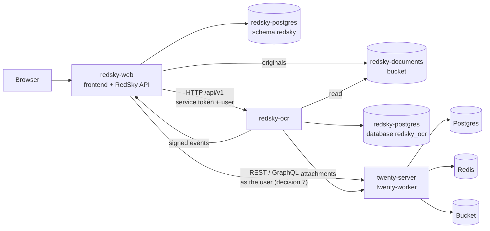

# RedSky architecture

This page has two parts. [Platform structure](#platform-structure) is the shape RedSky is being built toward: layers, services, repositories and the rules that hold them together. [The web app](#the-web-app) is the map for working in this repository's Next.js code. The reasoning behind the rules is in [`DECISIONS.md`](DECISIONS.md); the prototype audit is in [`IMPLEMENTATION_PLAN.md`](IMPLEMENTATION_PLAN.md).

## Platform structure

RedSky is RSM Capital's internal operating system. Twenty CRM is one system connected to it, and RedSky replaces it one area at a time.

### Repositories

| Repository | Holds | Railway services |
|---|---|---|
| `cody-rsm/redsky-core` (this one; formerly `cody-rsm/RedSky`) | The RedSky frontend and API (the Next.js app at the root), services under `services/`, and the platform documentation | `redsky-web`, `redsky-ocr` |
| `cody-rsm/redsky-twenty` (formerly `cody-rsm/rsm-crm`) | RSM's private copy of Twenty CRM and the Twenty apps that extend it | `twenty-server`, `twenty-worker` |

New platform code goes in `redsky-core`. `redsky-twenty` gets only what must live inside Twenty while Twenty owns CRM records ([decision 5](DECISIONS.md#5-two-repositories-redsky-core-for-the-platform-redsky-twenty-for-the-crm)).

### Layers

| Layer | Contents | Where it lives today |
|---|---|---|
| 1. UX | Home, CRM, Deals, Portfolio, Diligence, Documents, Intelligence, AI Assistant, Admin | `redsky-web` client (`src/app`, `src/components`). The only application staff use (decision 9); CRM records are read-only in it until the write path ([`CRM_INTEGRATION.md`](CRM_INTEGRATION.md)) |
| 2. Identity & API gateway | Auth, SSO, permissions, API routing, audit logs, rate limits | `redsky-web` server: `src/server/auth`, `security`, `http`. Entra ID |
| 3. Application services | Companies & People, Deal Pipeline, Portfolio, Diligence, Relationship Intelligence, Government Affairs, Tasks & Approvals, Reporting | `src/server/services` for RedSky-owned data; CRM records in Twenty, read through the Twenty adapter |
| 4. Integration hub | Connector SDK, credentials, OAuth, webhooks, sync workers, data mapping; Harmonic, PitchBook, AlphaSense, Carta, LegiStorm, Microsoft 365, Gödel Terminal, others | `src/server/integrations` (the Twenty adapter today). One adapter per source behind a normalized interface |
| 5. AI & intelligence | Anthropic, typed decision layer, agents and tool calling, MCP server, RAG and semantic search, entity resolution | `src/server/ai`. Retrieval over `redsky-ocr` chunks and pgvector is planned |
| 6. Document & OCR | Upload, OCR, text and table extraction, classification, metadata extraction, search indexing | `services/ocr` (`redsky-ocr`) |
| 7. Automation | Queues, scheduled jobs, event bus, approvals | Inside each service (`redsky-ocr` queues in Postgres). Between services: HTTP and signed events only |
| 8. Data & storage | PostgreSQL, pgvector, object storage, search index, source provenance | `redsky-postgres` (a schema or database per service), the `redsky-documents` bucket |
| 9. Hosting, security & ops | Railway, private networking, CI/CD, secrets, backups, monitoring, encryption | One Railway project; GitHub Actions; sealed variables |

Twenty sits beside the layers as a replaceable connected system: a separate repository and Railway service, reached only through its REST and GraphQL APIs, connected mainly to layers 3 and 4.

### Services



| Railway service | From | Role | State |
|---|---|---|---|
| `redsky-web` | `redsky-core`, root `Dockerfile` | Frontend and RedSky API in one Next.js app, at `redsky.rsmcapital.com` (decision 12). They can be split into two services later without changing any contract | Deployed |
| `redsky-postgres` | Railway PostgreSQL | RedSky's data: schema `redsky` for `redsky-web`, database `redsky_ocr` for `redsky-ocr` | Deployed (schema `redsky`) |
| `redsky-documents` | Railway bucket | Originals uploaded in RedSky | Built with Documents, not created on Railway yet |
| `redsky-ocr` | `redsky-core`, `services/ocr` | Document extraction. Private | Built and tested, not deployed |
| Sync worker | `redsky-core` | Scheduled connector syncs | Not built: added when the first connector needs one |
| `twenty-server`, `twenty-worker`, `Postgres`, `Redis`, `Bucket` | `redsky-twenty` | Twenty CRM and its own storage | Running (pre-production) |

Railway settings for each service are in [`DEPLOYMENT.md`](DEPLOYMENT.md).

### The rules

These four are decided ([`DECISIONS.md`](DECISIONS.md) 1 to 4). Changing one needs a new decision, not a quiet exception.

1. **One owner per record type.** Twenty owns CRM records today; RedSky owns its workspace data and documents. Areas move to RedSky one at a time (Documents first, then Deals), and each move changes the owner instead of adding a second one. Never sync records two ways between RedSky and Twenty. Twenty is retired when the last area has moved.
2. **One sign-in, permissions where the record lives.** Entra ID signs people in to both systems. When the RedSky API reads Twenty, it acts as the signed-in user, so Twenty's permissions and deal walls apply. RedSky's own records are authorized in `src/server/security/access-policy.ts`. Never use an all-access Twenty key while re-implementing Twenty's permissions in RedSky.
3. **Documents in RedSky storage.** Uploads go to the `redsky-documents` bucket; SharePoint stays the home of deal-system files and is reached as a source. Extracted text, chunks and embeddings stay in Postgres; only large outputs go in the bucket.
4. **HTTP contracts, no shared queues.** Services expose versioned HTTP APIs and send signed events to the RedSky API. No Redis or BullMQ queue is shared between the TypeScript API and Python services. Services are private; the frontend calls only the RedSky API. Each service owns its database or schema, and nothing reads Twenty's database.

Staff work only in RedSky (decision 9): a CRM feature staff need is built in RedSky's UI over the Twenty adapter, never as a Twenty screen for staff.

Build order: the RedSky API, frontend, Documents and identity first. Other areas wait until those work.

### Where new work goes

| Adding | Goes in |
|---|---|
| A page, widget or UI flow | `redsky-web`: `src/app`, `src/components` (see [Extending](#extending)) |
| An endpoint the frontend calls | `redsky-web`: `src/app/api` through `authedRoute`, logic in `src/server/services` |
| A record type RedSky owns | `src/server/db/schema.ts` (schema `redsky`), with a decision naming RedSky as its owner if Twenty owned it before |
| Reading CRM records | The Twenty adapter (`src/server/integrations/crm`), as the signed-in user (rule 2) |
| A data source (PitchBook, SharePoint, …) | An adapter under `src/server/integrations/<name>/` behind a normalized interface; a sync worker only when polling is needed |
| Heavy or non-TypeScript compute | A service under `services/<name>/` with its own Dockerfile, database, versioned API, CI workflow and README, called by the RedSky API |
| Document extraction | `services/ocr` |
| A field or object on records Twenty still owns | `redsky-twenty`, as a Twenty app (its `RSM_ARCHITECTURE.md`) |

### Document and OCR boundary

`redsky-ocr` is the first service under `services/`, and the pattern for the next ones:

- The RedSky API calls it with a service token and names the tenant and the signed-in user (`X-RedSky-Tenant-Id`, `X-RedSky-User-Id`). It trusts that decision and keeps no permission model.
- A document is a reference to a source: `storage` (a key in `redsky-documents`) or `twenty` (an attachment, while Twenty owns CRM records). SharePoint is the next source. The service only reads originals.
- It keeps derived data (pages, tables, chunks, Docling's document model) in its own `redsky_ocr` database and records the records a document belongs to as `{system, object, id}` links.
- When a job ends it sends `document.completed`, `document.needs_review` or `document.failed`, HMAC-signed, through a transactional outbox.

On the `redsky-web` side, `src/server/services/document-service.ts` stores uploads in the bucket (`src/server/documents/storage.ts`), registers them through a typed client (`src/server/documents/ocr-client.ts`), and keeps one `documents` row per file with its visibility and the status `redsky-ocr` last reported. Signed events arrive at `/api/internal/ocr/events` (verified in `src/server/documents/ocr-events.ts`); when they don't, the page re-reads statuses that are still in progress.

API, events, security and limits: [`services/ocr/README.md`](../services/ocr/README.md).

### Known gaps

- **The Twenty adapter uses a shared API key** (`TWENTY_API_KEY`), so every RedSky user sees what that key's role sees. This conflicts with rule 2. It is acceptable only while Twenty holds no real client data, and is replaced by per-user access ([decision 7](DECISIONS.md#7-how-the-redsky-api-reads-twenty-as-the-signed-in-user)).
- **Document sharing is "Only me" or "All RSM staff".** Team and deal-team visibility waits for team membership, which RedSky does not have yet (`Actor.teamIds`).
- **Twenty attachments are read by `redsky-ocr` but not listed in Documents**, and SharePoint is not a source yet. Listing them needs a per-user check against Twenty (rule 2), so the Twenty source stays off until per-user access exists ([`DEPLOYMENT.md`](DEPLOYMENT.md) §13).
- **Search shares the tenant with Twenty attachments.** `redsky-ocr` returns up to 50 hits across the tenant and `redsky-web` keeps only documents the user may see. With the Twenty source on, attachment hits could crowd out RedSky documents; add a source filter to `/api/v1/search` before turning it on.
- **Document search is full-text** (English), not semantic; embeddings and RedSky AI retrieval over documents come next.

## The web app

### Code map

```
src/
  app/                      Next.js routes
    (entry)/page.tsx        "/" → login, current onboarding step, or the employee's landing view
    login/                  Entra sign-in, or development persona sign-in (dev builds only)
    onboarding/[step]/      the 9-step flow; server checks the session and the furthest step reached
    (workspace)/            authenticated shell: home, people, pipeline, documents, m/[module]
    api/                    route handlers through server/http/api.ts → authedRoute, except health, auth callbacks and internal/ (signed service events)
  proxy.ts                  CSP nonce + security headers + optimistic redirect to /login
  components/
    ui/                     primitives (Radix-based dialog, switch, segmented, icon, avatar…) styled with the
                            prototype's classes
    layout/                 sidebar, top bar, notifications, demo switcher, workspace shell
    dashboard/              home view, widget frame/states, widget library, 13 widgets (widgets/)
    onboarding/             flow chrome and one component per step (steps/)
    workstyle/              intake, review form, profile summaries, recommendations, before/after preview
    documents/              upload form and document drawer (text, tables, actions)
    overlays/               command palette, AI panel, meeting prep, record preview, quick create
    settings/               settings modal and tabs
  features/                 isomorphic domain logic and catalogs (no I/O): personalization (recommend/pack),
                            preferences schema + patch transition, workstyle (rules, parser, apply), navigation,
                            onboarding steps, AI types, integrations catalog
  lib/
    api/contracts.ts        every shape exchanged between API and UI (normalized view models)
    client/                 TanStack Query hooks, Zustand UI store, workspace/layout/workstyle actions
    dates/                  pure date helpers (firm time zone)
  demo/                     the prototype's sample data, used only by the demo data provider
  server/                   server-only code ('server-only' import guard)
    config/env.ts           validated configuration; decides auth mode and data mode
    db/                     Drizzle schema (pgSchema 'redsky'), client, migration guard
    auth/                   Entra OIDC, sessions, user provisioning
    security/               access policy, audit log, crypto
    http/                   authedRoute wrapper, errors, rate limits
    services/               application services (all database access lives here)
    data/                   WorkspaceDataProvider: demo provider | production provider
    integrations/crm/       CrmAdapter interface + Twenty REST adapter
    ai/                     prompts, context retrieval, Anthropic provider, simulated provider
    workstyle/              PDF text extraction
    documents/              documents bucket (S3), redsky-ocr client, event signature check
drizzle/                    SQL migrations (generated by drizzle-kit, applied by scripts/migrate.ts)
services/ocr/               redsky-ocr, the Python document extraction service (its own README, Dockerfile and CI)
tests/unit, tests/e2e       Vitest and Playwright suites
```

### Request flow

1. `proxy.ts` sets a per-request CSP nonce and redirects requests without a session cookie to `/login`. The redirect is only optimistic; it is not the security check.
2. Server components (`(workspace)/layout.tsx`, `onboarding/[step]/page.tsx`) do the real check:
   - Validate the session (`getSessionUser`).
   - Enforce onboarding state.
   - Load the `ViewerPayload` (profile, preferences, layout, onboarding, workstyle summary, public config).
3. Client components read the viewer through `useViewer()` (TanStack Query, seeded from the server payload) and call `/api/*` with `apiFetch`.
4. `authedRoute` checks the Origin header on mutations, the session and rate limits, then calls a service with an `Actor`.
5. Services authorize through `security/access-policy.ts`, read and write the RedSky database, call the data provider for workspace data, and record audit events.

### Data modes

`getDataProvider()` returns `demoProvider` or `productionProvider` according to `REDSKY_DATA_MODE`. Both implement `WorkspaceDataProvider` and return the same contracts:

- `widget(id)` returns `{ status: 'ok', sample, data }` or `{ status: 'not_connected', source }`. Widgets render the second as the designed connector state.
- RedSky-owned data (tasks, preferences, Workstyle…) never goes through the provider. It is real in both modes.

### Personalization

`features/personalization/recommend.ts` ranks widgets from focus areas, goals and density (unit-tested against the SPEC §5.3 layouts). `features/preferences/apply.ts` is the single transition for preference changes, used by both the server (authoritative) and the client (optimistic updates):

- It re-recommends the layout when its inputs change, unless the employee arranged the layout by hand.
- Workstyle recommendations are applied over a baseline snapshot by `features/workstyle/apply.ts`, so switching one off restores the previous setting.

### Extending

- **A widget.**
  1. Add it to `WIDGETS` and `WIDGET_ORDER` in `features/personalization/catalog.ts`, and to the weights if it should be recommended.
  2. Add its data type to `WidgetDataMap`.
  3. Implement it in both providers.
  4. Create `components/dashboard/widgets/<name>-widget.tsx` using `WidgetFrame` and `WidgetBody`.
  5. Register it in `widgets/index.tsx`.
- **A connector.** For market and research data (Harmonic, PitchBook, AlphaSense), follow the rules in [`CRM_INTEGRATION.md`](CRM_INTEGRATION.md): enrichment only, explicit "Add to CRM", licence check first.
  1. Add it to `features/integrations/catalog.ts`.
  2. Implement an adapter under `server/integrations/<name>/` behind an interface with normalized models, as `crm/` does.
  3. Switch the relevant production-provider widget from `not_connected` to real data when the adapter is configured.
- **An AI tool or action.**
  1. Add a `proposedActionSchema` variant.
  2. If it changes data, make `actionRequiresConfirmation` return true.
  3. Implement execution in `services/confirm-service.ts`, which re-derives the action from server-side records and is idempotent per action key.
- **A table.**
  1. Edit `server/db/schema.ts` (inside `redsky`).
  2. Run `npm run db:generate`, and review the SQL in `drizzle/`.
  3. Commit it. Deployments apply it in the pre-deploy step.

### Twenty boundary

Twenty owns CRM records until each area moves to RedSky, and RedSky is the only application staff use ([`DECISIONS.md`](DECISIONS.md) 1 and 9). The plan and roadmap are in [`CRM_INTEGRATION.md`](CRM_INTEGRATION.md).

The UI never sees Twenty shapes. `server/integrations/crm/types.ts` defines `CrmContact`, `CrmCompany` and `CrmOpportunity`. `twenty-adapter.ts`:

- maps Twenty v2.44 REST records (the `cody-rsm/redsky-twenty` fork) into those types with Zod;
- treats every RSM custom field as optional;
- uses Bearer API-key auth, cursor pagination and an 8-second timeout;
- has a typed `CrmError`.

It is read-only in this release, and inactive unless `TWENTY_API_URL` and `TWENTY_API_KEY` are set. The shared key is a known gap against rule 2 (see [Known gaps](#known-gaps)): replace it with per-user access before Twenty holds real data, and keep the normalized types, so the adapter can be swapped for RedSky's own services as areas move.

Planned writes (roadmap step 2) come with per-user access: `CrmAdapter` gains create and update methods that call Twenty with the signed-in user's token. Each write is a structured action executed by `services/confirm-service.ts` after the confirmation dialog, with duplicate checks and an audit entry, like AI-proposed actions today; Twenty authorizes it. RedSky keeps no copy of CRM records.
