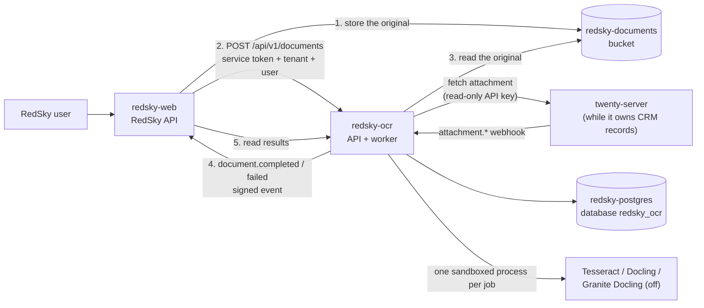

# redsky-ocr

RedSky's document extraction service: Layer 6 (Document & OCR) in [`docs/ARCHITECTURE.md`](../../docs/ARCHITECTURE.md#platform-structure). It turns PDFs, scans, photos, Word, PowerPoint and Excel files into page-referenced text, Markdown, tables and retrieval chunks. Everything runs on CPU inside the service: no document content goes to an outside OCR or AI service, and there are no per-page fees.

It is a private service. The RedSky API (`redsky-web`) calls it; browsers never do. It moved here from `cody-rsm/redsky-twenty` (formerly `rsm-crm`, `rsm/services/redsky-ocr`) with its history.

## How it fits



The rules it follows are the platform's ([`docs/DECISIONS.md`](../../docs/DECISIONS.md) 1 to 4):

- **The RedSky API decides who may see what.** It calls with a service token and names the tenant and the signed-in user (`X-RedSky-Tenant-Id`, `X-RedSky-User-Id`). This service trusts that decision and scopes every query to the tenant. It keeps no permission model of its own.
- **Originals stay with their owner.** A document is a reference to a *source*: a key in the RedSky documents bucket (`storage`), or a Twenty attachment (`twenty`). This service only reads originals and keeps what it derives: text, Markdown, tables, chunks, Docling's document model and processing state.
- **The contract is HTTP.** The versioned API below, plus signed "document finished" events back to the RedSky API. There is no shared queue between the TypeScript and Python code: the job queue is a Postgres table private to this service.
- **Links are labels, not permissions.** A document records the records it belongs to (`{system, object, id}`, for example `twenty/company/<uuid>`), so the API can list a company's documents. Access is never derived from them.

While Twenty owns CRM records, files people attach in Twenty are picked up too: Twenty sends `attachment.created` to the service, and a sweep every `REDSKY_OCR_RECONCILE_INTERVAL_SECONDS` (600) lists recent attachments and queues any whose webhook was missed (Twenty neither retries webhooks nor sends them while rate-limiting). `attachment.deleted` and `attachment.destroyed` purge everything derived from the file. Attachments from before deployment are a deliberate choice: `redsky-ocr backfill --since 2026-01-01`.

## Extraction

One engine runs per document, chosen by `auto` routing or named by the caller:

| Input | `auto` uses | What happens |
|---|---|---|
| DOCX, PPTX, XLSX | `docling` | Parsed natively (python-docx, python-pptx, openpyxl through Docling). Never OCRed. Headings, lists and tables kept; slides and sheets become pages |
| PDF | `docling` when its layout models are present, else `tesseract` | Each page is probed first. Pages with a usable text layer are read directly; only pages without one (or with a broken one, such as `(cid:12)` runs) are OCRed |
| PNG, JPEG, TIFF (multi-page) | `docling` when its layout models are present, else `tesseract` | OCRed |

| Engine | Does | Needs |
|---|---|---|
| `tesseract` | PDF text layer through pypdfium2, Tesseract OCR for the rest. Page text and confidence; **no table structure** | Nothing beyond the image |
| `docling` | Docling's layout model (headings, reading order) and TableFormer (tables), with Tesseract on bitmap regions only | Layout and TableFormer models baked into the image (`WITH_DOCLING_MODELS=true`), torch (CPU) |
| `granite_docling` | IBM's Granite Docling vision-language model, for layouts the others get wrong | **Off by default.** `remote` mode calls an OpenAI-compatible endpoint serving `ibm-granite/granite-docling-258M` on RSM hardware; `local` mode runs it here (slow on CPU) |

After extraction, quality checks flag empty output, mostly blank pages, garbled text and mean OCR confidence below `REDSKY_OCR_OCR_MIN_CONFIDENCE`. Flagged documents end as `needs_review` instead of `completed`.

Files whose name carries the RSM Deal System's `_NOAI` tag are recorded but never extracted, and cannot be reprocessed (nobody can waive `_NOAI`).

OCRmyPDF is not used. Docling and Tesseract already cover extraction; OCRmyPDF would only add searchable-PDF copies, and it depends on Ghostscript (AGPL or commercial), which waits on the AGPL decision ([`docs/DECISIONS.md`](../../docs/DECISIONS.md) 6).

### Model and dependency provenance

RSM excludes Chinese-developed OCR and foundation models. What runs here:

| Component | Origin | Licence | Notes |
|---|---|---|---|
| Docling (`docling-slim`, `docling-core`, `docling-parse`, `docling-ibm-models`) | IBM Research, now LF AI & Data | MIT | Installed as `docling-slim` with chosen extras. **Not** `docling`: that pulls `docling-slim[standard]`, which installs RapidOCR |
| Layout model `docling-project/docling-layout-heron` | IBM | Permissive per IBM's Docling docs; **confirm on the model card** | RT-DETRv2 architecture. RT-DETR was published by Baidu researchers; the weights here are IBM's, run through Hugging Face `transformers`. **Check the model card for whether IBM initialised training from Baidu's published checkpoints** before production: the build environment for this change could not reach Hugging Face |
| TableFormer `docling-project/docling-models` (`v2.3.0`) | IBM | Permissive per IBM's Docling docs; **confirm on the model card** | |
| Granite Docling 258M (optional) | IBM | Apache-2.0 (IBM's announcement; confirm on the model card) | IDEFICS3 architecture (Hugging Face), SigLIP2 vision encoder (Google), Granite LM (IBM) |
| Tesseract 5.3.4 and `eng` model | HP, then Google; Ubuntu packages | Apache-2.0 | |
| pypdfium2 / PDFium | Google | Apache-2.0 / BSD-3 | |
| torch, torchvision (CPU builds) | Meta / Linux Foundation | BSD-3 | From PyTorch's own index |
| boto3 / botocore | Amazon | Apache-2.0 | Reads originals from the bucket (S3 API) |
| FastAPI, uvicorn, httpx, psycopg | various | MIT, BSD-3, BSD-3, LGPL-3.0 | psycopg is used as an unmodified library |

Guards, not just intentions:
- `policy.py` refuses to start the service if `rapidocr`, `paddleocr`, `paddlepaddle`, `paddlex`, `qwen-vl-utils`, `modelscope`, `mineru`, `magic-pdf`, `deepseek-ocr` or `easyocr` is installed, or if the model folder holds anything not on its allow-list. `tests/test_policy.py` and CI check the same.
- The OCR engine is always named (`TesseractCliOcrOptions`). Docling's automatic choice would pick RapidOCR or EasyOCR if either were ever present.
- Granite Docling is the only VLM preset the code can select; Docling's Qwen, DeepSeek-OCR, GOT-OCR and MinerU presets are unreachable.
- `scripts/download_models.py` fetches named repositories only. Docling's own downloader is not used: its defaults also fetch RapidOCR weights.
- Docling's `vlm` extra is not installed; it brings `qwen-vl-utils`. Granite Docling needs only `transformers` and `accelerate` (the `granite` extra).

## API

Every `/api/v1` endpoint except the webhook needs `Authorization: Bearer <token>`. Responses use camelCase.

| Caller | Token | Also sends | Sees |
|---|---|---|---|
| The RedSky API | One of `REDSKY_OCR_SERVICE_TOKENS` | `X-RedSky-Tenant-Id`, `X-RedSky-User-Id` (recorded as the uploader or requester) | Everything in that tenant. The API has already decided the user may |
| A Twenty user (only with `REDSKY_OCR_ACCEPT_TWENTY_TOKENS=true`) | Their Twenty access token | | Twenty attachments Twenty lets them read, re-checked on every request. Never `storage` documents |

Twenty API keys are refused: access is decided per user.

| Method and path | Purpose |
|---|---|
| `POST /api/v1/documents` | JSON `{"source": {"system": "storage" \| "twenty", "id"}, "filename"?, "links"?, "engine"?}` registers a document and queues it. `storage`: the RedSky API only; `id` is the bucket key under `REDSKY_OCR_STORAGE_KEY_PREFIX`, `filename` is required, `links` are up to 20 `{system, object, id}`. `twenty`: `id` is an attachment id; links come from Twenty. `202` when created, `200` when it already existed |
| `GET /api/v1/documents` | List, filtered by `sourceSystem`, `sourceId`, `linkSystem`, `linkObject`, `linkId`, `status`; `limit` up to 100 |
| `GET /api/v1/documents/{id}` | Metadata, links, status, latest and current extraction, quality report, errors |
| `DELETE /api/v1/documents/{id}` | The RedSky API only. Purges everything derived from the document (not the original). `204` |
| `GET /api/v1/documents/{id}/content` | `format=json` (default: Markdown, text and pages with methods and confidence), `markdown` or `text`; `download=true` for a file. `409 CONTENT_NOT_READY` until the first extraction finishes |
| `GET /api/v1/documents/{id}/tables` | Tables as cell grids and Markdown, with page numbers |
| `GET /api/v1/documents/{id}/chunks` | Retrieval chunks (about 1,500 characters) with heading path and page range, for embeddings and cited answers. Carries `noAi` |
| `POST /api/v1/documents/{id}/reprocess` | `{"engine"}`. `409 EXTRACTION_IN_PROGRESS` if another engine is already queued, `422 ENGINE_UNAVAILABLE` if that engine is off. The previous result stays readable until the new one completes |
| `GET /api/v1/search?q=` | Full-text search (Postgres, English) over current extractions in the tenant, with page numbers and highlighted snippets |
| `GET /api/v1/engines` | Which engines and formats are usable in this deployment |
| `POST /api/v1/webhooks/twenty` | Twenty webhook receiver. HMAC-SHA256 over `timestamp:body` (`X-Twenty-Webhook-Signature`, `X-Twenty-Webhook-Timestamp`); requests older than five minutes are refused. 404 when no secret is configured |
| `GET /health`, `GET /ready` | Liveness; readiness (database and Tesseract), with the configured sources listed |

OpenAPI: `GET /api/v1/openapi.json`. There is no interactive documentation page.

**Statuses:** `uploaded` (recorded, not queued: `_NOAI`, or auto-processing off), `queued`, `processing`, `completed`, `failed`, `needs_review`. A document keeps serving its last good extraction while a reprocess runs or after one fails (`contentAvailable`).

**Errors** carry a stable `code`: `EMPTY_FILE`, `FILE_TOO_LARGE`, `UNSUPPORTED_TYPE`, `MACRO_ENABLED`, `ARCHIVE_BOMB`, `ENCRYPTED_FILE`, `CORRUPT_FILE`, `TOO_MANY_PAGES`, `IMAGE_TOO_LARGE`, `MALWARE_DETECTED`, `MALWARE_SCAN_FAILED`, `ENGINE_UNAVAILABLE`, `ENGINE_FAILED`, `PROCESSING_TIMEOUT`, `WORKER_CRASHED`, `SOURCE_UNAVAILABLE`, `SOURCE_DELETED`, `SOURCE_NOT_FOUND`, `SOURCE_NOT_CONFIGURED`, `NO_AI_DOCUMENT`.

### Events

With `REDSKY_OCR_EVENTS_URL` set (`redsky-web` receives them at `/api/internal/ocr/events`), the service POSTs `document.completed`, `document.needs_review` and `document.failed` to the RedSky API when a job ends (a retry is not an event), and `document.deleted` when a Twenty attachment's deletion purged a document:

```json
{"id": "…", "type": "document.completed", "occurredAt": "…", "tenantId": "…",
 "document": {"id": "…", "source": {"system": "storage", "id": "documents/…"}, "status": "completed", "statusReason": null},
 "extractionId": "…"}
```

- Headers: `X-RedSky-Event-Id`, `X-RedSky-Event-Type`, `X-RedSky-Timestamp` (Unix milliseconds) and `X-RedSky-Signature`, the hex HMAC-SHA256 of `timestamp + "." + body` with `REDSKY_OCR_EVENTS_SECRET`. The receiver verifies it over the raw body, refuses old timestamps, and treats the event id as an idempotency key.
- Events are written in the same transaction as the change they describe (an outbox table) and delivered at least once. Any 2xx counts as delivered. Failures back off from 30 seconds up to an hour; after 60 attempts (about two days) an event is abandoned and kept for inspection.
- An event says what changed, never what the document contains: the receiver reads results through the API.

## Processing and the queue

- The queue is the `redsky_ocr.extraction` table. Workers claim with `FOR UPDATE SKIP LOCKED`, heartbeat every 15 seconds, and a job whose heartbeat stops for two minutes is handed back. Only the worker holding a job can record its result.
- One queued or running extraction per document: duplicate webhooks and repeated requests collapse onto it.
- Retryable failures (bucket or Twenty unreachable, scanner unreachable, a crashed worker) back off 30 s, 60 s, 120 s, up to `REDSKY_OCR_JOB_MAX_ATTEMPTS`. Problems with the file itself fail at once.
- Each job runs in a fresh process in its own session. It is killed with its Tesseract children at `REDSKY_OCR_JOB_TIMEOUT_SECONDS`. The downloaded file and page images live in a per-job directory (mode 700) that is always deleted, also after a kill.
- `redsky-ocr serve` runs the API and `REDSKY_OCR_WORKER_CONCURRENCY` worker threads in one process. Threads only orchestrate; the extraction work is in the job processes. `redsky-ocr api` and `redsky-ocr worker` split the roles into separate services when needed, with no code change.

## Data

Database `redsky_ocr` (its own login, on `redsky-postgres`; never Twenty's Postgres), schema `redsky_ocr`:

| Table | Holds |
|---|---|
| `document` | One per source object: tenant, source system and id, source details, filename, MIME type (sniffed), size, SHA-256, uploader, `no_ai`, status, current extraction |
| `document_link` | The records a document belongs to, named by the system that owns each record |
| `extraction` | One per processing run, and the job queue: requested and actual engine and version, requester, attempts, routing decisions, quality report, full Markdown and text, errors, timings |
| `page` | Text and Markdown per page, method (`text_layer`, `ocr`, `native`, `layout`, `layout_ocr`, `vlm`), OCR confidence, size, full-text index |
| `extracted_table` | Cells as JSON, Markdown, page, caption |
| `chunk` | Retrieval units with headings and page range. An embedding column (pgvector) is the planned addition |
| `extraction_artifact` | Docling's lossless JSON, gzip-compressed, so chunking and exports can be redone without OCR |
| `sync_state` | How far the Twenty sweep has read |
| `event_outbox` | Events for the RedSky API, with delivery state |

Originals are not stored here. Deleting a document (by the API, or by deleting its Twenty attachment) deletes all of the above for it.

## Security

| Requirement | How |
|---|---|
| Authentication | Service tokens compared in constant time; several may be valid at once, for rotation; at least 32 characters. Twenty tokens, when enabled, are verified with Twenty (`currentUser`) and cached by SHA-256 for `REDSKY_OCR_AUTH_CACHE_SECONDS` (60 s); fails closed (503) when Twenty cannot be reached |
| Authorization | Tenant-scoped queries for every caller. The RedSky API is trusted for its tenant and user. Twenty users are checked per document and per request against the source attachment with their own token (cached at most 30 s). Not-visible and not-existing look the same |
| Service-to-service | Events are HMAC-signed and timestamped. Twenty webhooks are HMAC-signed and time-limited. The worker reads the bucket with storage credentials and refuses keys outside `REDSKY_OCR_STORAGE_KEY_PREFIX`; it fetches Twenty files with an API key whose role can only read attachments and their parent record types |
| Private traffic | On Railway, everything talks over `*.railway.internal`; the service has no public domain. File URLs signed for Twenty's public domain are rewritten to its private URL (`REDSKY_OCR_TWENTY_PUBLIC_URL`). Twenty downloads go only to allow-listed hosts and follow at most three redirects. No CORS: browsers never call the service |
| File validation | Type from content, not extension. Size limit before the body is read. Macro-enabled and legacy or encrypted Office files refused. ZIP entry count, expansion size and ratio limits. Page limit. Pixel limit (Pillow's decompression-bomb guard), and oversized PDF pages rendered within it |
| Request limits | Request bodies need a `Content-Length` and are capped (64 KB for registration, 1 MB for webhooks) |
| Malware | Optional ClamAV (`REDSKY_OCR_CLAMAV_HOST`), streamed to clamd before parsing; fails closed. Without it, the controls above plus sandboxed parsing with no code execution (macros are refused, not run) |
| Timeouts | Per job; per Tesseract page; Twenty calls 15 s; bucket reads 60 s |
| Logging | JSON logs with ids, codes and timings. Never document text, filenames' contents, tokens or search terms; no access log with query strings; exception messages from parsers are not logged (type and location only) |
| No outbound calls | Models are baked into the image at build time; the service runs with `HF_HUB_OFFLINE=1` and Docling's remote services off. It connects only to the bucket, the RedSky API (events), Twenty when configured, and clamd and the Granite endpoint when configured |
| Least privilege | Separate database login that cannot read RedSky's or Twenty's data. Container runs as an unprivileged user. Read-only use of the bucket and of Twenty |
| Secrets | Environment only (sealed on Railway). Never in the image or the repository. Empty variables count as unset, and blank secrets are refused |
| Encryption | Transport: Railway's private network (WireGuard-encrypted) inside the project, TLS at the edge. At rest: whatever Railway provides for Postgres volumes and buckets; this service adds no application-level encryption |

## Configuration

Variables use the `REDSKY_OCR_` prefix; see [`.env.example`](.env.example) for all of them with defaults, and [`railway.env.example`](railway.env.example) for Railway. The ones that matter:

| Variable | Default | |
|---|---|---|
| `DATABASE_URL` | required | `postgresql://redsky_ocr:…@host:5432/redsky_ocr` |
| `ADMIN_DATABASE_URL` | | First deploy only: creates the login and database named in `DATABASE_URL`. Remove afterwards |
| `SERVICE_TOKENS` | | Comma-separated bearer tokens for the RedSky API |
| `STORAGE_BUCKET`, `STORAGE_ENDPOINT`, `STORAGE_REGION`, `STORAGE_ACCESS_KEY_ID`, `STORAGE_SECRET_ACCESS_KEY` | | The RedSky documents bucket. Without them the `storage` source is off |
| `STORAGE_ADDRESSING_STYLE` | `virtual` | Railway buckets need `virtual`; `path` for MinIO or moto |
| `STORAGE_KEY_PREFIX` | `documents/` | Keys outside it are refused |
| `EVENTS_URL`, `EVENTS_SECRET` | | Where events go, and their signing secret |
| `TWENTY_URL` | | Twenty's private URL. Without it the `twenty` source is off |
| `TWENTY_PUBLIC_URL` | | Twenty's `SERVER_URL`, so its file links can be fetched privately |
| `TWENTY_API_KEY` | | Read-only key for fetching attachments |
| `TWENTY_WEBHOOK_SECRET` | | Enables the webhook receiver |
| `TWENTY_TENANT_ID` | Twenty's workspace id | Tenant recorded for Twenty attachments; the RedSky API must send the same value |
| `ACCEPT_TWENTY_TOKENS` | `false` | Let Twenty users call the service directly |
| `AUTO_PROCESS_ATTACHMENTS` | `true` | Queue every new Twenty attachment (webhook and sweep) |
| `RECONCILE_INTERVAL_SECONDS` | 600 | Sweep for attachments whose webhook was missed; 0 turns it off |
| `MAX_FILE_BYTES`, `MAX_PAGES`, `MAX_IMAGE_PIXELS` | 50 MB, 500, 60 MP | |
| `JOB_TIMEOUT_SECONDS`, `JOB_MAX_ATTEMPTS`, `WORKER_CONCURRENCY` | 900, 3, 1 | |
| `OCR_LANGUAGES`, `OCR_DPI`, `OCR_MIN_CONFIDENCE` | `eng`, 300, 60 | More languages need `tesseract-ocr-<lang>` in the Dockerfile |
| `GRANITE_DOCLING_MODE` | `off` | `off`, `local` or `remote` (`GRANITE_DOCLING_API_URL`, `GRANITE_DOCLING_API_KEY`) |
| `CLAMAV_HOST`, `CLAMAV_PORT` | | |

## Develop and test

```bash
cd services/ocr
uv venv -p 3.12 .venv
VIRTUAL_ENV=$PWD/.venv uv pip sync requirements-dev.lock
VIRTUAL_ENV=$PWD/.venv uv pip install --no-deps -e .
sudo apt-get install tesseract-ocr tesseract-ocr-eng     # or brew install tesseract

# Unit and integration tests. Database tests need a disposable Postgres:
REDSKY_OCR_TEST_DATABASE_URL=postgresql://postgres@127.0.0.1:5432/postgres .venv/bin/pytest
```

CI runs the same in [`.github/workflows/ocr.yml`](../../.github/workflows/ocr.yml) when anything under `services/ocr` changes.

### Dependencies

`pyproject.toml` declares them; three hashed lock files pin them: `requirements.lock` (the service), `requirements-models.lock` (adds the Docling model runtime; torch comes from PyTorch's index in the Dockerfile) and `requirements-dev.lock` (adds the test tools). After changing `pyproject.toml`, regenerate all three with [uv](https://docs.astral.sh/uv/), moving the cutoff date forward on purpose:

```bash
CUTOFF=2026-10-08T00:00:00Z
COMMON="--python-version 3.12 --python-platform x86_64-manylinux_2_28 --exclude-newer $CUTOFF --no-header -q"
uv pip compile pyproject.toml $COMMON --generate-hashes -o requirements.lock
EXCL=$(uv pip compile pyproject.toml --extra models $COMMON | grep -oE "^(torch|torchvision|triton|nvidia-[a-z0-9-]+)==" | tr -d '=' | sed 's/^/--no-emit-package /' | tr '\n' ' ')
uv pip compile pyproject.toml --extra models $COMMON --generate-hashes $EXCL -o requirements-models.lock
uv pip compile pyproject.toml --extra dev $COMMON --generate-hashes -o requirements-dev.lock
```

Then check that no forbidden package came in (`.venv/bin/python -c "from redsky_ocr import policy; policy.enforce(None)"` after syncing) and that each new package's origin is acceptable.

Tests run on a synthetic dataset generated at test time ([`tests/sample_documents.py`](tests/sample_documents.py); `python tests/sample_documents.py ./out` writes it to disk): native, scanned and mixed PDFs, PNG, JPEG, multi-page TIFF, DOCX, PPTX, XLSX, plus blank, encrypted, corrupt, macro-enabled, ZIP-bomb and pixel-bomb files. Everything is invented. The two tests marked `docling_models` run only when `REDSKY_OCR_DOCLING_ARTIFACTS_PATH` points at the models. The bucket is faked with moto; Twenty is faked with responses copied from a live Twenty 2.44 ([`tests/fake_twenty.py`](tests/fake_twenty.py)).

Against a real Twenty:

```bash
docker compose -f docker-compose.dev.yml up -d --build      # Twenty 2.44, Postgres, Redis
SECRET=$(openssl rand -hex 32)
python scripts/e2e_twenty.py bootstrap --webhook-secret "$SECRET"   # users, roles, API key, webhook
REDSKY_OCR_TWENTY_API_KEY=$(cat .e2e-api-key) REDSKY_OCR_TWENTY_WEBHOOK_SECRET=$SECRET \
  docker compose -f docker-compose.dev.yml --profile ocr up -d --build
# The bucket stand-in starts empty; create the documents bucket once:
.venv/bin/python -c "import boto3; boto3.client('s3', endpoint_url='http://localhost:5000', region_name='us-east-1', aws_access_key_id='testing', aws_secret_access_key='testing').create_bucket(Bucket='redsky-documents')"
python scripts/e2e_twenty.py run --service-token local-development-service-token-0123456789
```

Run it after every Twenty upgrade: it checks webhook ingestion, access denial for a user without file access, calls from the RedSky API, tenant separation, search filtering and purge on delete.

Benchmark: `python scripts/benchmark.py --runs 3` (add `REDSKY_OCR_DOCLING_ARTIFACTS_PATH` and the Granite variables to include those engines).

### Measured so far

`scripts/benchmark.py`, 3 runs each, 4 vCPU x86 container, 2026-10-20, `WITH_DOCLING_MODELS=false`:

| Engine | Document | Extraction (median) | With process start | Peak memory | Expected words found | Tables (expected) |
|---|---|---|---|---|---|---|
| tesseract | Native PDF, 2 pages | 0.01 s | 0.13 s | 121 MB | 100% | 0 (1) |
| tesseract | Scanned PDF, 2 pages, 300 dpi | 1.42 s | 1.54 s | 121 MB | 100% | — |
| tesseract | Mixed PDF (1 text page, 1 scan) | 0.54 s | 0.66 s | 121 MB | 100% | — |
| tesseract | PNG / JPEG / 2-page TIFF | 0.56 / 0.68 / 0.61 s | 0.67 / 0.80 / 0.73 s | 121 MB | 100% | — |
| docling | DOCX / PPTX / XLSX | 0.90 / 0.87 / 0.88 s | 1.25 / 1.19 / 1.23 s | 145-150 MB | 100% | 1 (1) / 1 (1) / 2 (2) |
| docling with layout models | PDF and images | not measured: models not reachable from the build environment | | | | |
| granite_docling | | not measured: off, no GPU | | | | |

Read these as a floor, not an accuracy claim: the synthetic scans are clean, single-column and printed in a common font. Real scans (skew, stamps, faxes, small print, columns) will score lower. The native PDF's table is found only by the `docling` engine. Run the benchmark on the Railway image, and on a handful of real but non-confidential RSM documents, before relying on the numbers.

## Deploy

Railway settings, variables and first-deployment steps: [`docs/DEPLOYMENT.md`](../../docs/DEPLOYMENT.md#13-optional-documents-and-redsky-ocr).

## Known limits

- The RedSky side is `redsky-web`'s Documents page (`src/server/services/document-service.ts`, the receiver at `/api/internal/ocr/events`). It shows only files uploaded in RedSky; Twenty attachments are processed here but not listed there yet.
- The `storage` source is tested against moto's S3, not yet against a Railway bucket.
- Not tested: the Docling layout/TableFormer path and Granite Docling, whose weights live on Hugging Face, which the environment that built this could not reach. The first Railway build downloads them; run the benchmark there.
- The `tesseract` engine finds no table structure in PDFs and images; tables there need the `docling` engine.
- Handwriting: Tesseract handles it poorly. Granite Docling is the route to try.
- Search is English full-text, not semantic.
